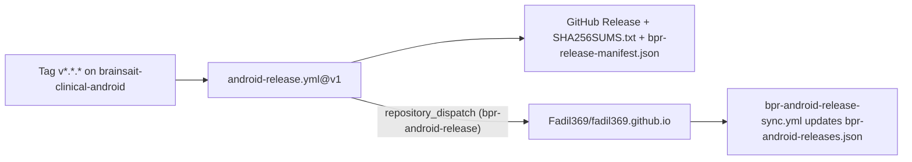

# Android, BPR PKI/FHIR Governance & Ecosystem Release Workflows

Reusable GitHub Actions workflows and standard-library governance tools for multi-module Kotlin /
Jetpack Compose Android healthcare suites (`brainsait-clinical-android`), BrainSAIT Provider
Registry (BPR) X.509 trust portals (`fadil369.github.io`), and synthetic FHIR R4 / NPHIES contracts.

> **Scope note.** Automated PKI chain checks, NPHIES identifier checksum validation, and neutral
> trust-enum enforcement protect repository integrity and prevent common regressions. They do not
> by themselves constitute HIPAA, Saudi PDPL, SCFHS, or NPHIES certification.

**ملخص بالعربية:** مجموعة مسارات عمل قابلة لإعادة الاستخدام لبناء تطبيقات أندرويد السريرية متعددة
الوحدات (`:core-fhir` و`:feature-bpr` و`:app-clinician` و`:app-patient`)، وإصدار الحزم الموقعة مع
بيان التحقق `SHA256SUMS.txt` ومزامنتها تلقائياً مع بوابة سجل الممارسين الصحيين (BPR)، والتحقق من
سلسلة شهادات الثقة X.509 وصلاحيتها ومطابقة حزم FHIR R4 / نفيس التجريبية وقيم الحالة المحايدة
(`NOT_ASSESSED`).

---

## Workflow overview

| File | Kind | Purpose |
|---|---|---|
| [`.github/workflows/android-ci.yml`](../.github/workflows/android-ci.yml) | Reusable (`workflow_call`) | Multi-module Android Gradle CI on Temurin JDK 17/21 with Gradle caching, unit tests, Android Lint, and debug APK artifacts. |
| [`.github/workflows/android-release.yml`](../.github/workflows/android-release.yml) | Reusable (`workflow_call`) | Release APK assembly with optional keystore signing + safe fallback, `SHA256SUMS.txt` + `bpr-release-manifest.json`, SLSA provenance attestation, GitHub Release publishing, and cross-repo `repository_dispatch`. |
| [`.github/workflows/bpr-trust-fhir-verify.yml`](../.github/workflows/bpr-trust-fhir-verify.yml) | Reusable (`workflow_call`) | Runs [`script/bpr-verify/bpr_verify.py`](../script/bpr-verify/bpr_verify.py) over X.509 PKI directories (`trust/`) and synthetic FHIR R4 / NPHIES / BPR JSON contracts, writing a step summary table and JSON report artifact. |
| [`.github/workflows/bpr-verify-tests.yml`](../.github/workflows/bpr-verify-tests.yml) | Internal CI | Runs `unittest` suite (`test_bpr_verify.py`) across Python 3.10 and 3.13. |
| [`.github/workflows/release-tag-sync.yml`](../.github/workflows/release-tag-sync.yml) | Internal automation | Fast-forwards floating major tags (e.g. `v1` for `v1.x.y`) on semver tag push or dispatch and ensures a GitHub Release exists with generated release notes. |

Copy-paste caller templates live in [`examples/android-bpr-app.yml`](../examples/android-bpr-app.yml)
and [`examples/bpr-web-hub.yml`](../examples/bpr-web-hub.yml).

---

## 1. `android-ci.yml` — Multi-Module Android Gradle CI

Designed for multi-module Kotlin / Jetpack Compose suites (`:core-fhir`, `:feature-bpr`,
`:app-clinician`, `:app-patient`). All third-party actions (`actions/checkout`,
`actions/setup-java`, `gradle/actions/setup-gradle`, `actions/upload-artifact`) are pinned to full
40-character commit SHAs on Node 24 majors, and Gradle arguments are validated against an allowlist
via environment variables so `${{ inputs.* }}` is never interpolated into shell scripts.

### Inputs

| Input | Default | Description |
|---|---|---|
| `java-version` | `"17"` | Temurin JDK version (`"17"` or `"21"`). |
| `working-directory` | `"."` | Relative path containing `gradlew`. |
| `gradle-test-tasks` | `"testDebugUnitTest"` | Space-separated unit-test tasks (`""` skips). |
| `gradle-lint-tasks` | `"lintDebug"` | Space-separated Android Lint tasks (`""` skips). |
| `gradle-assemble-tasks` | `"assembleDebug"` | Space-separated debug APK assemble tasks (`""` skips). |
| `gradle-extra-args` | `""` | Additional safe Gradle flags (e.g. `"--stacktrace"`). |
| `apk-artifact-glob` | `"**/build/outputs/apk/debug/*.apk"` | Glob (relative to `working-directory`) for debug APK upload. |
| `artifact-retention-days` | `14` | Retention days for JUnit XML, Lint HTML/SARIF, and debug APK artifacts. |
| `timeout-minutes` | `30` | Maximum job duration in minutes. |

### Private repository tip (`healthcare-security-scan.yml` pairing)

When pairing `android-ci.yml` with `healthcare-security-scan.yml` on a private repository that does
not have GitHub Advanced Security enabled, set `upload-sarif: false` and `codeql-languages: '["actions"]'`
(or `run-codeql: false`) so SARIF upload does not fail with HTTP 403 while keeping `gitleaks`,
`Trivy`, and `phi-scan` active.

---

## 2. `android-release.yml` — Signed/Fallback Release & Ecosystem Sync

Builds release APKs for `:app-clinician` and `:app-patient` (or any custom module list), stages
`SHA256SUMS.txt` and `bpr-release-manifest.json`, attests SLSA provenance, creates/updates a GitHub
Release, and optionally triggers `repository_dispatch` (`event_type: bpr-android-release`) on a
downstream hub such as `Fadil369/fadil369.github.io`.

### Caller permissions

```yaml
permissions:
  contents: write
  id-token: write
  attestations: write
```

### Inputs, secrets & outputs

| Name | Kind | Default / Required | Purpose |
|---|---|---|---|
| `modules` | input | `":app-clinician :app-patient"` | Modules converted to `<module>:assembleRelease`. |
| `gradle-release-tasks` | input | `""` | Explicit Gradle release task override. |
| `apk-glob` | input | `"**/build/outputs/apk/release/*.apk"` | Built release APK glob. |
| `suite-name` | input | `"brainsait-clinical-android"` | Recorded in `bpr-release-manifest.json`. |
| `fhir-version` | input | `"4.0.1"` | Recorded in `bpr-release-manifest.json`. |
| `nphies-profile` | input | `"ksa/nphies-fs"` | Recorded in `bpr-release-manifest.json`. |
| `version` | input | `""` | Explicit tag/version (auto-detects `github.ref_name` on tag pushes). |
| `create-release` | input | `true` | Publish/update GitHub Release with APKs, `SHA256SUMS.txt`, and manifest. |
| `attest` | input | `true` | Run `actions/attest-build-provenance` (auto-skipped on private repos unless `attest-private: true`). |
| `dispatch-repo` | input | `""` | Downstream `owner/repo` for `repository_dispatch` (e.g. `"Fadil369/fadil369.github.io"`). |
| `dispatch-event-type` | input | `"bpr-android-release"` | `event_type` sent in `repository_dispatch`. |
| `ANDROID_KEYSTORE_BASE64` | secret | optional | Base64 JKS/PKCS12 keystore. When omitted, builds cleanly with fallback signing. |
| `ANDROID_KEYSTORE_PASSWORD` | secret | optional | Keystore password (`RELEASE_STORE_PASSWORD`). |
| `ANDROID_KEY_ALIAS` | secret | optional | Signing key alias (`RELEASE_KEY_ALIAS`). |
| `ANDROID_KEY_PASSWORD` | secret | optional | Key password (`RELEASE_KEY_PASSWORD`). |
| `DISPATCH_TOKEN` | secret | optional | Fine-grained PAT with `Contents: write` on `dispatch-repo`. |
| `version`, `release-url`, `signing-mode`, `manifest-json` | outputs | — | Exposed to downstream caller jobs. |

### `bpr-release-manifest.json` & `repository_dispatch` contract



---

## 3. `bpr-trust-fhir-verify.yml` & `bpr_verify.py`

[`script/bpr-verify/bpr_verify.py`](../script/bpr-verify/bpr_verify.py) uses only the Python 3.10+
standard library and `openssl` CLI:

1. **X.509 PKI Trust Verification (`trust/`)**:
   - Parses PEM (`bpr-root.pem`, `bpr-issuing.pem`, `bpr-chain.pem`) and DER (`bpr-root.cer`)
     certificates via `openssl x509`.
   - Verifies Root CA self-issuance, `openssl verify -CAfile bpr-root.pem bpr-issuing.pem`,
     multi-cert chain bundles (`bpr-chain.pem`), DER/PEM SHA-256 parity (`bpr-root.cer` ==
     `bpr-root.pem`), and `fingerprints.txt` entries.
   - Enforces `notBefore <= now` and `days_remaining >= --min-days` (default `30` days).
2. **Synthetic FHIR R4 / NPHIES & BPR Governance**:
   - Validates FHIR R4 `resourceType`, `Bundle.type` + nested `entry[].resource`, and
     `CapabilityStatement.fhirVersion` (`4.0.x`).
   - Validates NPHIES Saudi National ID (`1\d{9}`) and Iqama (`2\d{9}`) prefixes and Luhn mod-10
     checksums across FHIR `identifier` entries and `BosEnrollmentDraft` payloads.
   - Enforces neutral `NOT_ASSESSED` / `not_assessed` trust semantics across Android
     (`licence_status`) and web (`trust.*`, `verification.*`, `verificationLevel`) schemas,
     rejecting non-neutral negative labels (`UNTRUSTED`, `FAKE`, `INVALID`, `FAILED`).
   - Flags unmasked non-synthetic emails/mobile numbers (`0500000000` / `example.com` are allowed)
     and US SSNs on patient payloads while masking values (`10******98`) in all logs and reports.

### Local CLI usage

```bash
python3 script/bpr-verify/bpr_verify.py \
  --root . \
  --trust-dir trust \
  --fhir-paths public/assets/bpr-data \
  --min-days 30 \
  --json-report bpr-verify-report.json
```

---

## 4. `release-tag-sync.yml` — Floating Major Tag Automation

Triggered automatically on `Fadil369/B.I.Lab` whenever a semver tag (`v1.0.0`, `v1.1.0`, …) is
pushed (or manually via `workflow_dispatch`). It resolves the highest semver tag in that major
series, force-updates the annotated floating major tag (`v1`), and creates the GitHub Release with
generated release notes if one does not already exist.
